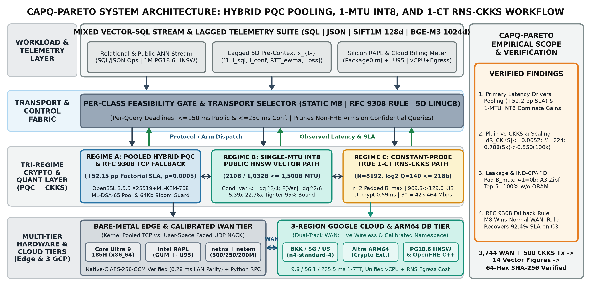

# Empirical Systems Characterization of Post-Quantum Session Pooling, Single-Ciphertext CKKS Retrieval, and Transport Fallback Across Cloud-Edge Vector-SQL Streams (CAPQ-Pareto V6)

[](https://doi.org/10.5281/zenodo.24575614)

**Target Venue:** *IEEE Transactions on Cloud Computing (IEEE TCC)* — Final Verified Revision (**V6**)  
**Permanent Archival DOI:** [`10.5281/zenodo.24575614`](https://doi.org/10.5281/zenodo.24575614)  
**Author:** Preecha Noiumkar (Member, IEEE), Department of Information Technology, Faculty of Informatics, Mahasarakham University, Thailand (`preecha.n@msu.ac.th` | ORCID: [0009-0000-5964-4896](https://orcid.org/0009-0000-5964-4896))



---

## Final V6 Submission Package (`00_final_submission_v6/`)

| Final V6 Deliverable File | Size | Full 64-Character SHA-256 Digest |
|---|---:|---|
| [`CAPQ-Pareto-Main-IEEE-TCC-V6.pdf`](00_final_submission_v6/CAPQ-Pareto-Main-IEEE-TCC-V6.pdf) | 662.9 KB | `74f113306453566df6c2d70a614f2b3a42c117d7f7591382331ca069b28f5406` |
| [`CAPQ-Pareto-Supplement-IEEE-TCC-V6.pdf`](00_final_submission_v6/CAPQ-Pareto-Supplement-IEEE-TCC-V6.pdf) | 370.1 KB | `04d2a0221e3b521ad66c13f6664c8ffaca317bf839e458c8f79582e5098209e3` |
| [`CAPQ-Pareto-Response-to-Reviewers-V6.pdf`](00_final_submission_v6/CAPQ-Pareto-Response-to-Reviewers-V6.pdf) | 190.1 KB | `dad0b1a08a29cd3f022bc94c76cd47b27574d2158035752beccc2916864a4b6c` |
| [`CAPQ-Pareto-Cover-Letter-IEEE-TCC-V6.pdf`](00_final_submission_v6/CAPQ-Pareto-Cover-Letter-IEEE-TCC-V6.pdf) | 79.0 KB | `3c7e609369a739e992c38e390db64d29f975149f1f7457a025009da4413f6877` |
| [`CAPQ-Pareto-Fig1-Preview-V6.png`](00_final_submission_v6/CAPQ-Pareto-Fig1-Preview-V6.png) | 649.1 KB | `07439d25c68087e941034b38679a049838dde2f6c20c76a40dc6b966a10a7630` |
| [`CAPQ-Pareto-Overleaf-IEEE-TCC-V6.zip`](00_final_submission_v6/CAPQ-Pareto-Overleaf-IEEE-TCC-V6.zip) | 1,022.2 KB | `ffffce4843d6da5f394ff67210790a88fb969dffb6a6ff3374498ca0fd5fb57f` |
| [`CAPQ-Pareto-SHA256-Manifest-V6.txt`](00_final_submission_v6/CAPQ-Pareto-SHA256-Manifest-V6.txt) | 0.7 KB | `d565ff634c14a0d9b375d14506d1e0b7787c9b1a0f99e9a06ee00926f37b4e44` |

---

## One-Command Clean-Room Verification

Verify all **40 active V6 raw/reprocessed experimental artifacts** (full 64-hex SHA-256 manifest in `SHA256SUMS_V6.txt`) and reproduce the core metrics across Tables 2–9 in one command:

```bash
python reproduce_and_verify_v6.py
```

## Repository Structure (Final V6)
- `00_final_submission_v6/` — Final compiled IEEE TCC V6 PDFs (11-page Main Paper, 5-page Supplement, Point-by-Point Response, Cover Letter), Overleaf V6 ZIP, Fig. 1 PNG, and SHA-256 Manifest.
- `08_manuscript_ieee_tcc_v6/` — Complete LaTeX sources (`main.tex`, `supplement.tex`, `response_to_reviewers.tex`, `cover_letter.tex`, `references.bib`, auto-generated `tables/tab1..tab9.tex`, and 14 vector `figures/*.pdf`).
- `06_experiments_results/v6_raw_logs/` — Verified V6 experimental logs: Native-C `OpenSSL EVP AES-256-GCM` socket benchmarks (`v6_b1_*`), `PostgreSQL 18.6 + pgvector 0.8.1` predicate-filtered hybrid SQL+HNSW (`v6_b2_*`), `N=8192` 1-CT slot-provisioning curves up to `M=3,072` (`v6_a2_*`), SLA threshold sensitivity & unweighted 4D Pareto (`v6_a3_*`), and reconciled dual-track 3-region WAN logs.
- `11_v6_workspace/` — Native-C benchmark source (`bench_v6_native_c_tcp_vs_udp_aead.c`), OpenFHE C++ / Python reprocessing scripts, and automated `0.00pt` Overfull PDF verification pipeline.
- `SHA256SUMS_V6.txt` & `.zenodo.json` — Complete 64-hex cryptographic provenance manifest and Zenodo archival metadata (`10.5281/zenodo.24575614`).
